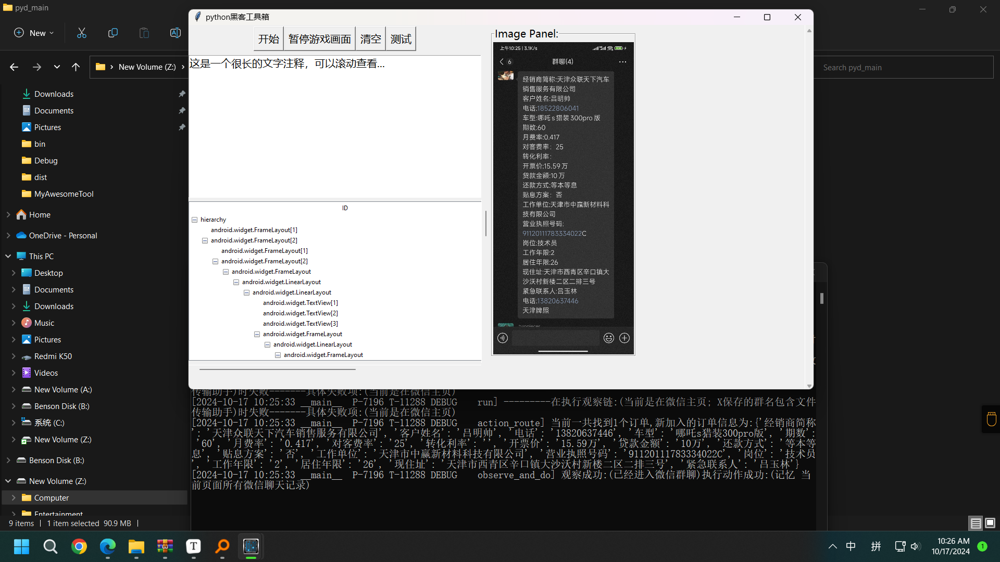

# 项目介绍



项目参考：本项目基于本人的https://github.com/delayboy/GenshinHelper/tree/main 原神冷却监控项目进行改版。

项目功能：进入手机主页，点击微信，并找到群聊，进入群聊，按照最近日期翻找订单内容，并解析记忆，最终当日期到达上限时，脚本将会挂机原地不动


## 项目待完善功能

- 相比GenshinHelper项目，本项目目前缺少基于taskId的多任务分类，和状态转移，当需要在大型任务之间切换时，taskId的引入是必要的
- 相比GenshinHelper项目，本项目目前缺少基于taskErrorReward的任务超时机制（看门狗机制），当机器人卡在某个任务循环中时，无法摆脱该循环，造成永久性坏死问题

## 项目的进步

- 相比GenshinHelper项目，本项目引入了 `AgentTreeMemory` 、`CommandInterpreter` 、`StringClassifier` 等新一代高效数据结构。

- 其中 `AgentTreeMemory` 用于在可变长、可读性记忆链条中发挥关键作用，数据结构的调用示例如下

  ```python
  remember_this_info(ele_list[i].get_rect().get_middle(), "左下角微信两个字")
  remember_this_info(ele_list[i].get_rect().get_middle(),"秃顶热身王", "左下角微信两个字")
  
  if_remember_this_info("当前页面所有微信群名", "秃顶热身王")
  if_remember_this_info("当前页面所有微信群名", "秃顶热身王","群聊内容")
  
  get_remember_info("当前页面所有微信群名", "秃顶热身王")
  get_remember_info("当前页面所有微信群名", "秃顶热身王","群聊内容")
  
  forget_this_info("当前页面所有微信群名", "秃顶热身王")
  forget_this_info("当前页面所有微信群名")
  
  ```

-  `AgentTreeMemory` 实现了两种记忆模式，分别为一次观察一刷新的**短期记忆**模式，和通过**"遗忘"和"记忆"关键字**自主控制生命周期的**长期记忆**模式：

  ```python
  def __init__(self, main_ui: MainUI):
          self.pc = PhoneController(main_ui)
          # __agent_long_memory
          # 智能体长期记忆，通过触发action动作来手动控制，记忆的清除和写入
          self.__alm: AgentTreeMemory = AgentTreeMemory()  
          # 短期记忆，看一次更新一次，由脚本自动控制生命周期
          self.__observation_shot_memory_xml_cache: Dict[str, bool] = {}  
          # __agent_shot_memory
           # 短期记忆，看一次更新一次，由脚本自动控制生命周期
          self.__asm: AgentTreeMemory = AgentTreeMemory() 
  ```

  

- `CommandInterpreter` 用于在可读性代码解释上，发挥baseline的基本作用

  > "当前是在微信主页; X题头是微信两个字" 的解析过程:
  >
  > 解析指令1：当前是在微信主页
  >
  > 解析指令2：题头是微信两个字 (需要取反)
  >
  > "遗忘 当前页面所有微信群名; 点击 左下角微信两个字"  的解析过程:
  >
  > 解析指令1：遗忘  入参: 当前页面所有微信群名
  >
  > 解析指令2：点击  入参：左下角微信两个字

- `CommandInterpreter` 通过run函数将，解析后的指令，引导到动作路由和观察路由函数上

  ```python
  def observe_and_do(self, observe_cmd: str, action_cmd: str, is_final=True):
          ob_i = CommandInterpreter(observe_cmd, self.observation_xml_route)
          if ob_i.run():
              a_i = CommandInterpreter(action_cmd, self.action_route)
              if a_i.run():
                  logger.debug(f"观察成功:({observe_cmd})执行动作成功:({action_cmd})")
                  self.__default_final_exit(is_final)
                  
  def observation_xml_route(self, *args) -> bool:
          result = True
          observation_alias_name = args[0]
          if self.__observation_shot_memory_xml_cache.__contains__(observation_alias_name):
              result = self.__observation_shot_memory_xml_cache[observation_alias_name]
              return result
  def action_route(self, *args) -> bool:
          action_alias_name = args[0]
          if action_alias_name.__eq__("记忆"):
              switch_name = args[1]
  ```

- `StringClassifier` 作为新一代的字符分类器，借鉴了正则表达式的解析思路，通过状态机转移+字符聚类的设计思路，用户可重写，状态机转移条件，和字符分类方式，将对应字符分配到一起。

  ```python
  class WxStringClassifier(StringClassifier):
      def on_pipline(self, input_tuple_c: Tuple[str, str]) -> Any: 
          ch, new_state = input_tuple_c
          self.ignored = False
          if self.state in ["is_space", "is_symbol", "is_@"]: # "在状态机为@符号和空格时忽略builder收集行为"
              self.ignored = True
          if ch == ' ':
              new_state = "is_space"
          elif ch in [':', '：']:
              new_state = "is_symbol"
          elif ch in ['\n', '\r']:
              new_state = "is_div"
          elif ch == '@':
              new_state = 'is_@'
          else:
              new_state = "is_text"
  
          if self.state == "is_text" and new_state == "is_space": # 忽略对应的状态转移更新
              pass
          elif self.state == "is_@" and new_state == "is_text":  # @后忽略对应的状态转移更新
              pass
          else:
  
              self.state = new_state
          return self.state
  ```

  

# 开发方式

## 无需安装python环境-快速启动

- 使用embedding python launcher

双击运行\dist\pyd_main\pyd_main.exe可启动嵌入式python解释器，任何电脑无需安装环境，即可运行python脚本。

如果您想更改脚本，请在\dist\pyd_main\patch.py中进行编辑，并定义如下入口函数，用于加载您的python代码，注意入口函数的代码定义尽量不要更改，否则将会造成代码的加载异常

```python
def main(patch_md5: str):
    if patch_md5 is None or patch_md5 == auto_patch_python(None):
        MainUI(main_loop).myloop()
    else:
        time.sleep(1)
        print("等待正确的MD5 patch")
```

当您需要编辑自动化脚本时，请进入脚本入口函数loop_entry_point处修改代码，并添加新的功能。

```python
def loop_entry_point(self):
        # self.pc.capture_screen()
        # self.pc.capture_hierarchy_root_xml()
        self.pc.wait_for_debug()
        self._clear_cache()
        try:
            self.observe_and_do("当前是在微信主页; X题头是微信两个字",
                                "遗忘 当前页面所有微信群名; 点击 左下角微信两个字")
            self.observe_and_do("当前是在微信主页; 题头是微信两个字", "记忆 当前页面所有微信群名")
            self.observe_and_do("当前是在微信主页; 找到秃顶群聊", "点击 群聊按钮")
            self.observe_and_do("当前是在微信主页; 保存的群名包含文件传输助手", "向上滑动")
            self.observe_and_do("当前是在微信主页; X保存的群名包含文件传输助手", "向下滑动")
            self.observe_and_do("已经进入微信群聊", "记忆 当前页面所有微信聊天记录")
            self.observe_and_do("已经进入微信群聊; X当前聊天存在2天前的信息", "向下滑动")
            self.observe_and_do("当前在手机主页; 找到微信APP", "遗忘 当前页面所有微信群名; 点击 微信APP")
            self.observe_and_do("当前在手机主页; X找到微信APP", "遗忘 当前页面所有微信群名; 向右滑动")
        except OverflowError:
            pass
```

## 使用pycharm等编辑器打开项目

- 打开README所在目录作为项目根目录，运行patch.py或pyd_main.py两个入口文件，任意其中一个即可

- 安装基本依赖库，参见pyd_main.py的hidden_imports()函数

  ```python
  def hidden_imports():
      from PIL import Image, ImageTk  # pillow型图片支持库
      import tkinter as tk  # 窗口控件支持库
      import base64
      from typing import List, TypeVar, Callable, Generic, Dict, Tuple, Sequence
      import ctypes
      import numpy as np
      import threading
      import time
      import os
      import cv2
      import datetime
      import ctypes
      import time
      from tkinter import ttk
      from uiautomator2 import core
      import pdb
  
      import numpy.ctypeslib as npct
      import numpy as np
      from typing import Callable, Any
      import win32gui
      import subprocess
      import threading
      from abc import abstractmethod
      import logging
      import os
      import datetime
      from logging.handlers import TimedRotatingFileHandler, RotatingFileHandler
      import hashlib
  
      # 银行自动化
      import socket
      import time
      from typing import Dict, List, Callable, TypeVar
      import threading
      import ctypes
      import numpy as np
      import PyTools.MyAwesomeTool.MyDll as MyDllLib
      import PyTools.MyAwesomeTool.MyUtil
      import PyTools.MyAwesomeTool.MyTcpHelper
      import PyTools.MyAwesomeTool.PyUseCPlus
      import PyTools.MyAwesomeTool.MyProcessHelper
      import PyTools.MyAwesomeTool.MyLinkHelper
      import os
      import threading
      import time
      from typing import List, TypeVar, Callable, Generic, Tuple, Any, Dict, Type
      import uiautomator2 as u2
      import cv2
      import ctypes
      import numpy as np
      from lxml.etree import _Element as MyXmlElement
      from PyTools.MyAwesomeTool.PyUseCPlus import Rect, PyRect, MainUI, MyOpenCv, start_thread, build_logger
      from PyTools.MyAwesomeTool.MyUtil import group_str_pipline, WxStringClassifier, TimeStringClassifier
      import re
      from datetime import datetime, timedelta
  
      # 剪贴板辅助
      import os.path
      import threading
      import time
      import pyaudio
      import soundfile
      import cv2
      import numpy as np
      import win32clipboard
      from PyTools.MyAwesomeTool.MyDll import HookPackage
      import PyTools.MyAwesomeTool.MyDll as MyDll
      from PyTools.MyAwesomeTool.PyUseCPlus import WinManager, start_thread, image_to_binary_arr, binary_arr_to_image, Rect, \
          MyOpenCv, AndroidApp
      from PyTools.MyAwesomeTool.MyTcpHelper import TcpServer, TcpClient, TcpHandler, PackageHeader, TcpBase
      from PyTools.MyAwesomeTool.MyUtil import auto_patch_python
      from PyTools.MyAwesomeTool.KeDaSoundToText import ke_da_main
      from PIL import Image
      import matplotlib.pyplot as plt
      import locale
  
      # 强制设置系统默认编码为UTF-8
      import easyocr
  ```

  

- 您也可以选择，安装非常多的依赖库，由于本人将历史上所有项目都共享在同一个python环境下，因此依赖库过多，不推荐使用这种方式

  ```shell
  absl-py==1.4.0
  accelerate==0.21.0
  adbutils==2.8.0
  addict==2.4.0
  aenum==3.1.15
  aiofiles==23.1.0
  aiohttp==3.8.4
  aiosignal==1.3.1
  aliyun-python-sdk-alimt==3.2.0
  aliyun-python-sdk-core==2.13.36
  aliyun-python-sdk-kms==2.16.1
  altair==5.0.1
  altgraph==0.17.4
  AMFM-decompy==1.0.11
  aniso8601==9.0.1
  antlr4-python3-runtime==4.9.3
  anyio==3.7.0
  apkutils2==1.0.0
  argon2-cffi==21.3.0
  argon2-cffi-bindings==21.2.0
  arrow==1.2.3
  arxiv==1.4.7
  asttokens==2.2.1
  astunparse==1.6.3
  async-timeout==4.0.2
  asynctest==0.13.0
  attrs==23.1.0
  audioread==3.0.0
  av==10.0.0
  Babel==2.12.1
  backcall==0.2.0
  backports.functools-lru-cache==2.0.0
  basicsr==1.4.2
  beautifulsoup4==4.12.2
  bidict==0.22.1
  bleach==6.0.0
  blendmodes==2022
  blinker==1.6.2
  boltons==23.0.0
  boto3==1.28.44
  botocore==1.31.44
  Bottleneck==1.3.7
  box2d-py==2.3.8
  cached-property==1.5.2
  cachetools==5.3.1
  capstone==5.0.1
  certifi==2023.5.7
  cffi==1.15.1
  chardet==5.2.0
  charset-normalizer==3.1.0
  cigam==0.0.3
  clean-fid==0.1.35
  click==8.1.3
  clip==1.0
  clldutils==3.19.0
  cloudpickle==2.2.1
  cmudict==1.0.26
  cn2an==0.5.22
  colorama==0.4.6
  coloredlogs==14.0
  colorlog==6.7.0
  comm==0.1.3
  comtypes==1.4.7
  construct==2.10.70
  contourpy==1.0.7
  cpm-kernels==1.0.11
  crcmod==1.7
  cryptography==41.0.3
  cssselect2==0.7.0
  csvw==3.1.3
  cycler==0.11.0
  Cython==3.0.0b2
  dataclasses-json==0.5.14
  datasets==2.13.0
  debugpy==1.6.7
  decorator==4.4.2
  defusedxml==0.7.1
  demucs==4.0.1
  Deprecated==1.2.14
  deprecation==2.1.0
  diffusers==0.20.2
  dill==0.3.6
  Distance==0.1.3
  dlinfo==1.2.1
  dnspython==2.3.0
  docopt==0.6.2
  dora_search==0.1.12
  easyocr==1.7.1
  edit-distance==1.0.6
  editdistance==0.6.2
  einops==0.8.0
  einx==0.3.0
  eng-to-ipa==0.0.2
  entrypoints==0.4
  espnet-tts-frontend==0.0.3
  et-xmlfile==1.1.0
  eventlet==0.33.3
  executing==1.2.0
  facebook-wda==1.4.9
  facexlib==0.3.0
  faiss-cpu==1.7.4
  fastapi==0.94.0
  fastjsonschema==2.17.1
  feedparser==6.0.10
  ffmpeg==1.4
  ffmpy==0.3.0
  filelock==3.12.0
  filterpy==1.4.5
  Flask==2.2.5
  Flask-Cors==4.0.0
  Flask-RESTful==0.3.10
  Flask-SocketIO==5.3.6
  flask-talisman==1.1.0
  flatbuffers==23.5.26
  flwr==1.5.0
  fonttools==4.39.4
  fqdn==1.5.1
  frozendict==2.4.4
  frozenlist==1.3.3
  fsspec==2023.5.0
  ftfy==6.1.1
  fugashi==1.3.2
  funasr==0.7.6
  future==0.18.3
  fvcore==0.1.5.post20221221
  g2p==1.1.20230822
  g2p-en==2.1.0
  gast==0.4.0
  gdown==4.7.1
  gensim==4.3.1
  gfpgan==1.3.8
  gitdb==4.0.10
  GitPython==3.1.32
  gmpy2==2.1.5
  google-auth==2.19.1
  google-auth-oauthlib==1.0.0
  google-pasta==0.2.0
  GPUtil==1.4.0
  gradio==3.41.2
  gradio_client==0.5.0
  greenlet==2.0.2
  grpcio==1.54.2
  gym==0.26.2
  gym-notices==0.0.8
  h11==0.12.0
  h5py==3.8.0
  httpcore==0.15.0
  httpx==0.24.1
  huggingface-hub==0.15.1
  humanfriendly==10.0
  icetk==0.0.4
  idna==3.4
  imageio==2.31.3
  imageio-ffmpeg==0.5.1
  imgviz==1.7.5
  importlib-metadata==6.6.0
  importlib-resources==5.12.0
  indic-transliteration==2.3.60
  inflect==7.0.0
  inflection==0.5.1
  iopath==0.1.9
  ipykernel==6.23.1
  ipython==8.14.0
  ipython-genutils==0.2.0
  ipywidgets==8.0.6
  isodate==0.6.1
  isoduration==20.11.0
  iterators==0.0.2
  itsdangerous==2.1.2
  jaconv==0.3.4
  jamo==0.4.1
  jax==0.4.16
  jedi==0.18.2
  jieba==0.42.1
  Jinja2==3.1.2
  jmespath==0.10.0
  joblib==1.3.1
  jsonmerge==1.8.0
  jsonpointer==2.3
  jsonschema==4.17.3
  julius==0.2.7
  jupyter==1.0.0
  jupyter-console==6.6.3
  jupyter-events==0.6.3
  jupyter_client==8.2.0
  jupyter_core==5.3.0
  jupyter_server==2.6.0
  jupyter_server_terminals==0.4.4
  jupyterlab-pygments==0.2.2
  jupyterlab-widgets==3.0.7
  kaldi-io==0.9.8
  kaldiio==2.18.0
  keras==2.12.0
  Keras-Preprocessing==1.1.2
  keystone-engine==0.9.2
  kiwisolver==1.4.4
  ko-pron==1.3
  kornia==0.6.7
  labelme==5.4.1
  lameenc==1.7.0
  langchain==0.0.256
  langid==1.1.6
  langsmith==0.0.19
  language-tags==1.2.0
  lark==1.1.2
  latex2mathml==3.76.0
  lazy_loader==0.3
  libclang==16.0.0
  librosa==0.9.1
  lightning-utilities==0.9.0
  linkify-it-py==2.0.2
  llvmlite==0.40.1
  lmdb==1.4.1
  loguru==0.7.2
  logzero==1.7.0
  lpips==0.1.4
  lxml==4.9.2
  Markdown==3.4.3
  markdown-it-py==2.2.0
  MarkupSafe==2.1.3
  marshmallow==3.20.1
  matplotlib==3.7.1
  matplotlib-inline==0.1.6
  mdit-py-plugins==0.3.3
  mdtex2html==1.2.0
  mdurl==0.1.2
  mecab-python3==1.0.9
  mediapipe==0.10.3
  mistune==2.0.5
  ml-dtypes==0.3.0
  modelscope==1.9.0
  more-itertools==10.3.0
  moviepy==1.0.3
  mpmath==1.3.0
  ms-swift==1.0.0
  multidict==6.0.4
  multiprocess==0.70.14
  munkres==1.1.4
  mypy-extensions==1.0.0
  Naked==0.1.32
  nara-wpe==0.0.9
  natsort==8.4.0
  nbclassic==1.0.0
  nbclient==0.8.0
  nbconvert==7.4.0
  nbformat==5.9.0
  nest-asyncio==1.5.6
  networkx==2.8.4
  ninja==1.11.1.1
  nltk==3.8.1
  notebook==6.5.4
  notebook_shim==0.2.3
  num-thai==0.0.5
  num2words==0.5.13
  numba==0.57.1
  numexpr==2.8.5
  numpy==1.24.3
  oauthlib==3.2.2
  omegaconf==2.2.3
  onnxruntime==1.15.1
  open-clip-torch==2.20.0
  openai==0.27.7
  openai-whisper==20231117
  openapi-schema-pydantic==1.2.4
  OpenCC==1.1.7
  opencv-contrib-python==4.8.0.76
  opencv-python==4.8.0.76
  opencv-python-headless==4.8.0.76
  openpyxl==3.1.2
  openunmix==1.3.0
  opt-einsum==3.3.0
  orjson==3.9.0
  oss2==2.18.1
  outcome==1.2.0
  overrides==7.3.1
  packaging==23.1
  pandas==2.0.2
  pandocfilters==1.5.0
  panphon==0.20.0
  parso==0.8.3
  pathos==0.3.0
  pefile==2023.2.7
  peft==0.5.0
  phonemizer==3.2.1
  phrasetree==0.0.8
  pickleshare==0.7.5
  piexif==1.1.3
  Pillow==9.5.0
  pkginfo==1.9.6
  pkgutil_resolve_name==1.3.10
  platformdirs==3.5.1
  pocketsphinx==5.0.1
  pooch==1.7.0
  portalocker==2.7.0
  pox==0.3.3
  ppft==1.7.6.7
  proces==0.1.6
  proglog==0.1.10
  prometheus-client==0.17.0
  prompt-toolkit==3.0.38
  protobuf==3.20.3
  psutil==5.9.5
  pure-eval==0.2.2
  py==1.11.0
  pyarrow==12.0.1
  pyasn1==0.5.0
  pyasn1-modules==0.3.0
  PyAudio==0.2.13
  pybind11-stubgen==2.5.1
  pyclipper==1.3.0.post5
  pycparser==2.21
  pycryptodome==3.18.0
  pydantic==1.10.8
  pydeck==0.8.0
  pydub==0.25.1
  pyelftools==0.31
  PyExecJS==1.5.1
  pyfunctional==1.4.3
  pygame==2.4.0
  Pygments==2.15.1
  pyinstaller==6.0.0
  pyinstaller-hooks-contrib==2023.9
  pykakasi==2.3.0
  pylatexenc==2.10
  Pympler==1.0.1
  PyMuPDF==1.22.3
  PyMySQL==1.0.3
  pynvml==11.5.0
  pyopenjtalk==0.3.4
  pyopenjtalk-prebuilt==0.3.0
  pyparsing==3.0.9
  pypinyin==0.49.0
  PyQt5==5.15.10
  PyQt5-Qt5==5.15.2
  PyQt5-sip==12.13.0
  pyre-extensions==0.0.29
  pyreadline3==3.4.1
  pyrsistent==0.19.3
  PySnooper==1.2.0
  PySocks==1.7.1
  python-bidi==0.6.0
  python-dateutil==2.8.2
  python-docx==0.8.11
  python-dotenv==1.0.0
  python-engineio==4.7.0
  python-json-logger==2.0.7
  python-markdown-math==0.8
  python-multipart==0.0.6
  python-socketio==5.9.0
  pytorch-lightning==1.9.4
  pytorch-wpe==0.0.1
  pytz==2023.3
  pytz-deprecation-shim==0.1.0.post0
  PyWavelets==1.4.1
  pywin32==306
  pywin32-ctypes==0.2.2
  pywinpty==2.0.10
  PyYAML==6.0
  pyzmq==25.1.0
  qtconsole==5.4.3
  QtPy==2.3.1
  rdflib==7.0.0
  realesrgan==0.3.0
  regex==2023.6.3
  reportlab==4.0.4
  requests==2.31.0
  requests-oauthlib==1.3.1
  resampy==0.4.2
  resize-right==0.0.2
  retry==0.9.2
  retrying==1.3.4
  rfc3339-validator==0.1.4
  rfc3986==1.5.0
  rfc3986-validator==0.1.1
  rich==13.4.1
  roman==4.2
  rotary-embedding-torch==0.2.7
  rouge-chinese==1.0.3
  rsa==4.9
  ruamel.yaml==0.17.32
  ruamel.yaml.clib==0.2.7
  s3transfer==0.6.2
  safetensors==0.3.1
  sagemath==1.3.0
  scikit-image==0.21.0
  scikit-learn==1.3.0
  scipy==1.10.1
  segment-anything==1.0
  segments==2.2.1
  selenium==4.13.0
  semantic-version==2.10.0
  Send2Trash==1.8.2
  sentence-transformers==2.2.2
  sentencepiece==0.1.99
  sgmllib3k==1.0.0
  shapely==2.0.6
  shellescape==3.8.1
  shellingham==1.5.4
  simplejson==3.19.1
  six==1.16.0
  smart-open==6.3.0
  smmap==5.0.0
  sniffio==1.3.0
  sortedcontainers==2.4.0
  sounddevice==0.4.6
  soundfile==0.12.1
  soupsieve==2.4.1
  SQLAlchemy==2.0.19
  stack-data==0.6.2
  starlette==0.26.1
  streamlit==1.25.0
  streamlit-chat==0.1.1
  submitit==1.5.1
  supervision==0.14.0
  svglib==1.5.1
  sympy==1.12
  tabulate==0.9.0
  tb-nightly==2.15.0a20230910
  tenacity==8.2.2
  tensorboard==2.12.3
  tensorboard-data-server==0.7.0
  tensorboard-plugin-wit==1.8.1
  tensorflow==2.12.1
  tensorflow-estimator==2.12.0
  tensorflow-intel==2.12.1
  tensorflow-io-gcs-filesystem==0.31.0
  termcolor==2.3.0
  terminado==0.17.1
  text-unidecode==1.3
  TextGrid==1.5
  threadpoolctl==3.2.0
  tifffile==2023.8.30
  tiktoken==0.4.0
  timm==0.9.2
  tinycss2==1.2.1
  tokenizers==0.13.3
  tomesd==0.1.3
  toml==0.10.2
  tomli==2.0.1
  toolz==0.12.0
  toposort==1.10
  torch==2.0.1+cu117
  torch-complex==0.4.3
  torch_geometric==2.5.3
  torchaudio==2.0.2
  torchdiffeq==0.2.3
  torchinfo==1.8.0
  torchmetrics==1.1.1
  torchsde==0.2.5
  torchvision==0.15.2
  tornado==6.3.2
  tqdm==4.65.0
  traitlets==5.9.0
  trampoline==0.1.2
  transformers==4.30.2
  treetable==0.2.5
  trimesh==4.3.2
  trio==0.22.2
  trio-websocket==0.11.1
  typer==0.12.3
  typing-inspect==0.9.0
  typing_extensions==4.5.0
  tzdata==2023.3
  tzlocal==4.3.1
  uc-micro-py==1.0.2
  uiautomation==2.0.20
  uiautomator2==3.2.5
  unicodecsv==0.14.1
  Unidecode==1.3.6
  unidic-lite==1.0.8
  uri-template==1.2.0
  uritemplate==4.1.1
  urllib3==1.26.16
  uvicorn==0.22.0
  validators==0.20.0
  vector-quantize-pytorch==1.15.3
  watchdog==3.0.0
  wcwidth==0.2.6
  wdapy==0.2.4
  webcolors==1.13
  webencodings==0.5.1
  websocket-client==1.5.2
  websockets==11.0.3
  weditor==0.7.3
  Werkzeug==2.2.3
  widgetsnbextension==4.0.7
  win32-setctime==1.1.0
  wrapt==1.14.1
  wsproto==1.2.0
  xformers==0.0.20
  xlrd==2.0.1
  xlwt==1.3.0
  xmltodict==0.14.1
  xxhash==3.2.0
  yacs==0.1.8
  yapf==0.40.1
  yarl==1.9.2
  zipp==3.15.0
  
  ```